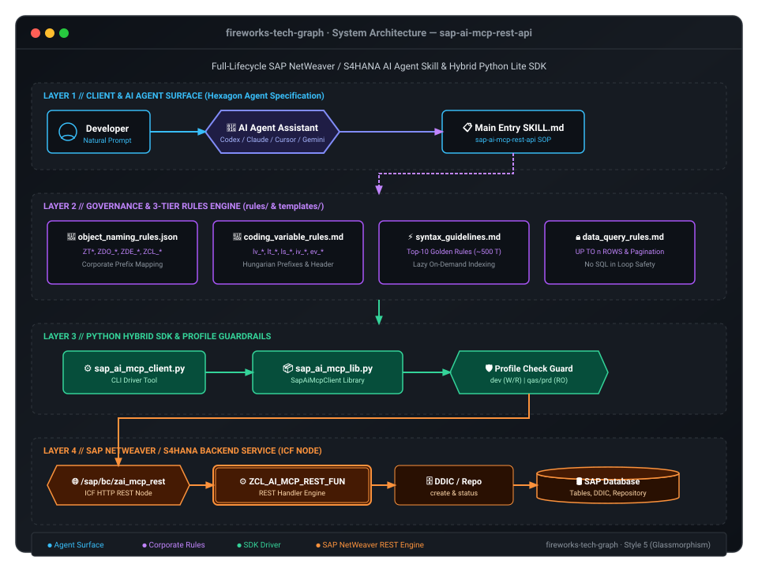
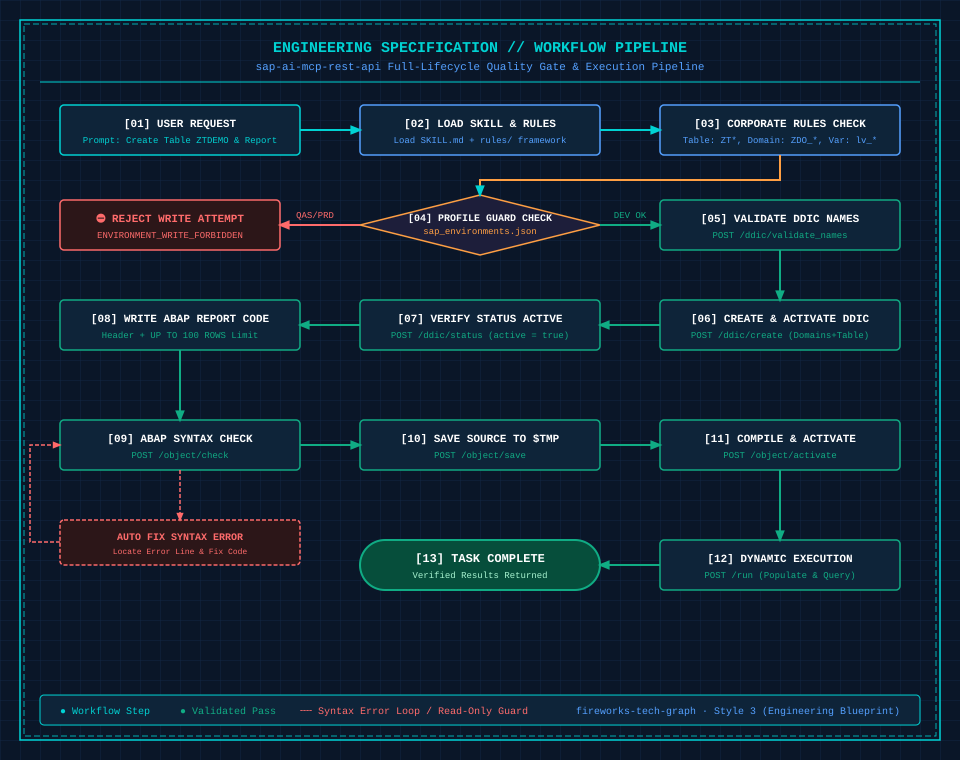

# SAP AI MCP REST API (Skill & SDK)

> **Enterprise-grade native SAP NetWeaver / S/4HANA development, DDIC modeling, and DevOps automation skill engine designed for modern AI Coding Agents (Cursor, Claude Code, Antigravity, Windsurf, Cline).**

[](https://www.sap.com)
[](https://www.python.org)
[]()
[](LICENSE)
[]()

[English Document](README.md) | [中文说明文档](README.zh.md)

---

## 🌟 Highlights

* **Native Backend with Zero External SDK Dependencies**: No SAP GUI, SAP JCo, RFC SDK, or Node.js required on the server. Operates directly via an ICF HTTP endpoint (`/sap/bc/zai_mcp_rest`) powered by a single ABAP handler class ([`ZCL_AI_MCP_REST_FUN.abap`](./ZCL_AI_MCP_REST_FUN.abap)).
* **Full-Lifecycle Development Automation**: Covers the complete closed-loop cycle from natural language requirement ➔ naming convention matching ➔ DDIC modeling & activation ➔ source code generation & syntax self-healing ➔ Dynpro screen & GUI status creation ➔ unit test / FM execution ➔ automated CTS / TOC deployment.
* **Dual ALV Report Generation Engines**:
  * **Enterprise OO ALV**: Automatically generates Screen 9000 Dynpro, mounts `CL_GUI_CUSTOM_CONTAINER`, creates clean standard GUI status (`STATUS_9000`), and binds ALV grid events without macro hacks.
  * **Standard Functional FM ALV**: Instant generation and deployment of enterprise reports based on `REUSE_ALV_GRID_DISPLAY_LVC` with GUI status replication.
* **Multi-Environment Guardrails**: Built-in profile isolation (DEV for read-write, QAS for controlled test imports, PRD strictly read-only for diagnostics). Client-side pre-flight checks enforce valid Workbench transport requests for non-local packages.
* **Built-in ABAP Standards & Knowledge Base**: Embedded enterprise naming standards (`golden_rules.md`), variable Hungarian notation, and comprehensive 150k+ word S/4HANA modern syntax guidelines.

---

## 🏗️ Architecture & Execution Flow

### 1. System Architecture



### 2. Execution Workflow



---

## 📦 Directory Structure

```text
sap-abap-mcp/
├── SKILL.md                          # AI Agent skill definition and entrypoint
├── README.md                         # English documentation (this file)
├── README.zh.md                      # Chinese documentation
├── ZCL_AI_MCP_REST_FUN.abap          # SAP backend REST handler class (~10,000 lines of ABAP)
├── assets/                           # High-resolution vector diagrams (Architecture & Workflow)
├── config/
│   ├── sap_environments.json.example# Public example configuration template
│   └── sap_environments.json        # Local environment profile configuration (protected by .gitignore)
├── rules/                            # Coding standards and comprehensive ABAP syntax guides
│   ├── golden_rules.md               # Core naming conventions, variable prefixes, and query constraints
│   ├── abap_syntax_guide_classic.md  # Classic ABAP syntax reference manual (71,000 words)
│   └── abap_syntax_guide_s4hana.md   # Modern ABAP 7.5+ / S/4HANA syntax manual (78,000 words)
├── references/                       # Standard Operating Procedures (SOPs) & troubleshooting guides
│   ├── playbook_inspect_and_read.md  # ① Inspect / Diagnose / Query SOP
│   ├── playbook_develop_and_deploy.md# ② Develop / Syntax check / Activate SOP
│   ├── playbook_transport_pipeline.md# ③ CTS Transport Request / TOC CI/CD pipeline SOP
│   ├── endpoints.md                  # Complete REST endpoint specifications & contracts
│   ├── environments.md               # Multi-environment configuration documentation
│   ├── examples.md                   # Real-world usage examples
│   ├── policy.md                     # Security policy and access boundary
│   └── troubleshooting.md            # Troubleshooting & self-healing guide
├── skills/                           # Built-in specialized report sub-skills
│   ├── sap-create-oo-alv-report/     # 1) Enterprise OO ALV Report Generator (Screen 9000 + Blank Status)
│   └── sap-create-fm-alv-report/     # 2) Standard FM ALV Report Generator (REUSE_ALV_GRID_DISPLAY_LVC)
├── templates/                        # Reusable template library
│   ├── oo_alv_template.abap          # Enterprise OO ALV report template
│   ├── dynpro_9000_template.json     # Screen 9000 custom container layout template
│   ├── fm_alv_template.abap          # Standard functional FM ALV report template
│   ├── abap_header.txt               # Standard report/class header comment template
│   └── table_audit_fields.json       # Audit fields template for transparent tables
└── scripts/                          # Client-side SDK and CLI tools
    ├── sap_ai_mcp_client.py          # Unified CLI client tool
    ├── sap_ai_mcp_lib.py             # Core Python SDK library
    ├── sap_ai_mcp_call.py            # Low-level HTTP caller with guardrail checks
    └── sap_ai_mcp_debug.py           # Debugging and ad-hoc test runner
```

---

## 🚀 Quickstart

### Step 1: SAP Backend Deployment (Takes ~3 minutes)

1. **Import Handler Class**:
   - Log in to your SAP system and open transaction `SE24`.
   - Create a global class named `ZCL_AI_MCP_REST_FUN` (Description: `AI MCP REST API Handler`).
   - Switch to **Source Code-Based** view, paste the entire content from [`ZCL_AI_MCP_REST_FUN.abap`](./ZCL_AI_MCP_REST_FUN.abap), and **activate** it.
2. **Activate ICF HTTP Node**:
   - Open transaction `SICF` and navigate to `/default_host/sap/bc/`.
   - Create a new sub-element named `zai_mcp_rest`.
   - Under the **Handler List** tab, enter `ZCL_AI_MCP_REST_FUN`.
   - Right-click the newly created service node and select **Activate Service**.

> 💡 **Endpoint URL**: The standard service URL format is: `http(s)://<hostname>:<port>/sap/bc/zai_mcp_rest?sap-client=<client>`.

---

### Step 2: Client Configuration

1. **Prerequisites** (Python 3.9+ required):
   ```bash
   pip install requests
   ```
2. **Setup Connection Profiles**:
   ```bash
   cd config
   cp sap_environments.json.example sap_environments.json
   ```
   Edit `sap_environments.json` with your target SAP system credentials:
   ```json
   {
     "default_profile": "dev200",
     "profiles": {
       "dev200": {
         "description": "SAP Development Environment (Client 200)",
         "base_url": "http://your-sap-host:50000/sap/bc/zai_mcp_rest?sap-client=200",
         "user": "YOUR_DEV_USER",
         "password": "YOUR_PASSWORD",
         "allow_write": true
       },
       "qas600": {
         "description": "SAP Test Environment (Client 600 - Controlled Import)",
         "base_url": "http://your-sap-host:50000/sap/bc/zai_mcp_rest?sap-client=600",
         "user": "YOUR_QAS_USER",
         "password": "YOUR_PASSWORD",
         "allow_write": false
       }
     }
   }
   ```
   *(Credentials can also be securely injected via environment variables: `SAP_DEV_USER` / `SAP_DEV_PASSWORD`)*

3. **Verify Connectivity**:
   ```bash
   python3 scripts/sap_ai_mcp_client.py --profile dev200 capabilities
   ```
   A successful response listing supported capability endpoints confirms proper setup!

---

## 🤖 Cross-AI Agent Integration Guide

This repository natively functions as an **Agent Skill** across major modern AI coding assistants.

> 📌 **Dedicated Agent Prompt**: We provide **[`AGENT_GUIDE.md`](./AGENT_GUIDE.md)** specifically formatted for AI Agents to ingest. Load it as system instructions or workspace rules to equip your agent with autonomous execution and safety boundary awareness.

### 1. Claude Code
Create or edit `CLAUDE.md` in your project root:
```markdown
# SAP ABAP Development Guidelines
For all SAP operations, read and strictly adhere to `AGENT_GUIDE.md`:
- Unified execution tool: `python3 scripts/sap_ai_mcp_client.py --profile <env> <command>`
- Development & deployment must use `--profile dev` with an active transport request (`transport`)
- Quality system imports must use `--profile qas transport import`
- Naming & variable structure must follow `rules/golden_rules.md`
```

### 2. Cursor
Create `.cursor/rules/sap-abap.mdc` (or root `.cursorrules`):
```markdown
---
description: SAP ABAP Development & Tooling Rules
globs: ["*.abap", "*.json"]
---
You are an expert SAP ABAP Developer.
- All SAP operations must be routed through `python3 scripts/sap_ai_mcp_client.py`.
- Strictly follow the workflows and guardrails defined in `AGENT_GUIDE.md`.
- Never modify code on non-DEV systems. Always require Workbench transport requests for non-local packages.
- Enforce Hungarian notation (lv_, lt_, ls_) from `rules/golden_rules.md`.
```

### 3. Windsurf
Create `.windsurfrules` in your workspace root with the same instructions as Cursor.

### 4. Cline / Roo Code (VS Code Extension)
Create `.clinerules` in your workspace root and paste the prompt block above.

### 5. Google Antigravity / Gemini Code Assist
Symlink this repository directly into your Agent skills directory:
```bash
ln -s /path/to/skill-abap ~/.gemini/config/skills/sap-ai-mcp-rest-api
```
The agent automatically detects root [`SKILL.md`](./SKILL.md) and indexes all Playbooks.

---

## 💻 Common Usage & CLI Cheat Sheet

### 1. Inspect Objects & Query Tables
```bash
# Read report source code
python3 scripts/sap_ai_mcp_client.py --profile dev200 read report ZREP_DEMO

# Read transparent table with auto-pagination safeguard
python3 scripts/sap_ai_mcp_client.py --profile dev200 table read MARA --max-rows 10
```

### 2. Check, Save & Activate Programs
```bash
# Check syntax of a local ABAP file against the server
python3 scripts/sap_ai_mcp_client.py --profile dev200 report check --file my_report.abap

# Save and activate report with automatic GUI status copying
python3 scripts/sap_ai_mcp_client.py --profile dev200 report deploy \
  --name ZREP_DEMO \
  --package ZDEV \
  --transport S4HK900001 \
  --file my_report.abap \
  --copy-gui
```

### 3. Deploy Enterprise OO ALV Report (Screen 9000 + Blank Status)
Create complete OO ALV reports with screen and clean status definitions using Python SDK:
```python
from sap_ai_mcp_lib import SapAiMcpClient

client = SapAiMcpClient(profile='dev200')

res = client.call('report_deploy', {
    "object_name": "ZREP_OO_ALV_DEMO",
    "package": "ZDEV",
    "transport": "S4HK900001",
    "source_code": oo_alv_source_code,
    "copy_gui": True,
    "gui_mode": "CREATE_BLANK",       # Creates native clean STATUS_9000 with Back/Exit keys
    "gui_target_status": "STATUS_9000"
})
```

### 4. Non-Intrusive TOC CI/CD Deployment Pipeline
Deploy code to test environments using Transport of Copies (TOC) without releasing open developer tasks:
```bash
# 1. Create a TOC request in DEV
python3 scripts/sap_ai_mcp_client.py --profile dev200 transport create --type T --text "TOC_AUTO_TEST" --target "QAS"

# 2. Copy objects from active workbench request to the TOC
python3 scripts/sap_ai_mcp_client.py --profile dev200 transport copy --source-tr S4HK900001 --target-tr S4HK900002

# 3. Release the TOC request
python3 scripts/sap_ai_mcp_client.py --profile dev200 transport release --trkorr S4HK900002

# 4. Import TOC into QAS (use test environment profile)
python3 scripts/sap_ai_mcp_client.py --profile qas600 transport import --trkorr S4HK900002
```

---

## 🛡️ Security & Compliance Guardrails

To prevent production disruption and data corruption, strict policies are enforced across client and server:
1. **No Code Modification on Non-DEV Systems**: Profiles with `allow_write: false` reject any mutating call prior to issuing network requests.
2. **Mandatory CTS Transport Tracking**: Every object modification under a transportable package requires an explicit transport request number.
3. **Self-Preservation Protection**: Server logic explicitly blocks modifying or deleting the handler class `ZCL_AI_MCP_REST_FUN`.
4. **SQL Execution Quotas**: Table reads automatically enforce result row caps and field whitelists to avoid runaway memory consumption.

---

## 🤝 Contributing

Contributions, issues, and feature requests are welcome!
1. Fork this repository and create a new feature branch.
2. When adding or updating endpoints, update `references/endpoints.md` and the SDK client in tandem.
3. Ensure all contract tests pass via `python3 -m unittest discover tests`.

---

## 📄 License

This project is licensed under the [MIT License](LICENSE).
