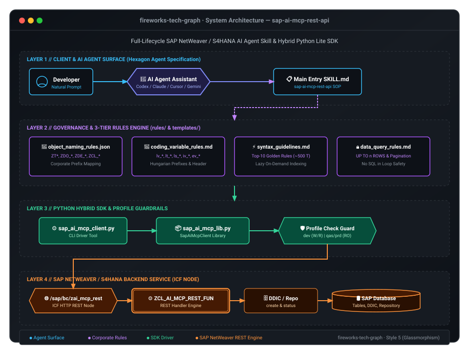
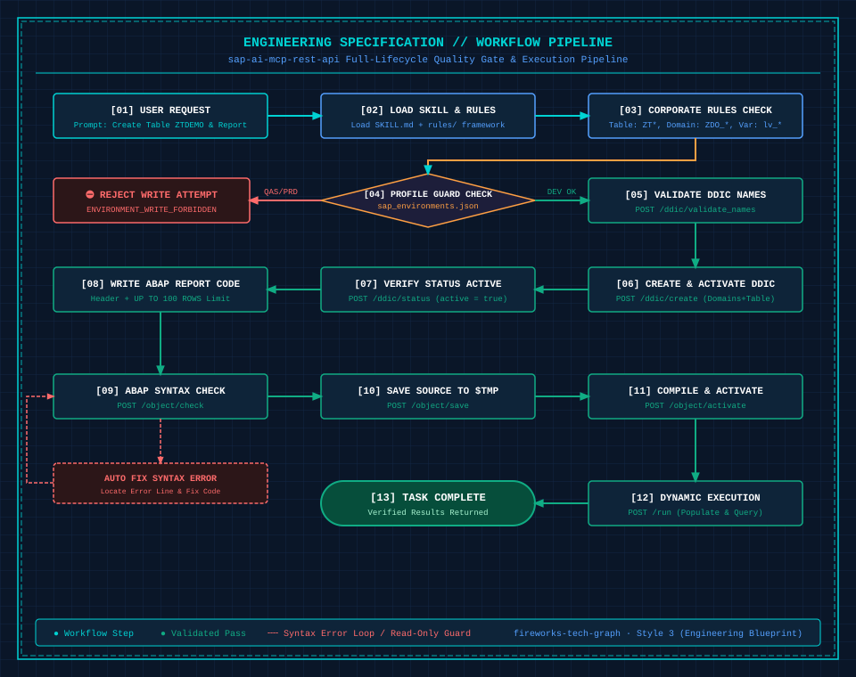

# SAP AI MCP REST API (Skill & SDK)

> **面向现代 AI Agent (Cursor, Claude Code, Antigravity, Windsurf, Cline) 的企业级 SAP NetWeaver / S/4HANA 原生全生命周期开发、DDIC 建模与自动化运维 Skill 引擎。**

[](https://www.sap.com)
[](https://www.python.org)
[]()
[](LICENSE)
[]()

[English Document](README.md) | [中文说明文档](README.zh.md)

---

## 🌟 项目亮点 (Highlights)

* **纯原生后端，零外部 SDK 依赖**：无需安装 SAP GUI、SAP JCo、RFC SDK 或 Node 环境，仅基于 SAP 原生 HTTP 节点 (`/sap/bc/zai_mcp_rest`) 与单个 ABAP 类 (`ZCL_AI_MCP_REST_FUN.abap`) 即可驱动。
* **全生命周期开发自动化**：覆盖「需求理解 ➔ 命名规范匹配 ➔ DDIC 模型创建激活 ➔ 报表/类代码生成与语法自愈 ➔ Dynpro 屏幕与 GUI 状态构建 ➔ 单元测试与 FM 执行 ➔ CTS / TOC 自动化发布」完整闭环。
* **双 ALV 自动化生成引擎**：
  * **企业级面向对象 OO ALV**：自动创建 Dynpro 9000 屏幕、挂载 Custom Container、原生生成标准返回按键的空白 GUI 状态并完成组装。
  * **标准函数式 FM ALV**：基于 `REUSE_ALV_GRID_DISPLAY_LVC` 的企业报表秒级一键部署与 GUI Status 复制。
* **多环境安全防线 (Multi-Environment Guardrails)**：原生环境隔离（DEV 读写、QAS 受控测试、PRD 严格只读诊断）；客户端写操作强制校验有效 Workbench 传输请求。
* **内置企业级 ABAP 规范与语法智库**：包含命名约束（`golden_rules.md`）、经典语法及 15 万字 S/4HANA 7.5+ 现代语法备查知识库。

---

## 🏗️ 架构与技术原理 (Architecture)

### 1. 系统整体架构 (System Architecture)



### 2. 自动化执行流水线 (Execution Workflow)



---

## 📦 目录结构 (Directory Structure)

```text
sap-abap-mcp/
├── SKILL.md                          # AI Agent Skill 规则定义与调度入口
├── README.md                         # 英文说明文档
├── README.zh.md                      # 中文说明文档
├── ZCL_AI_MCP_REST_FUN.abap          # SAP 后端 REST 服务处理类 (~10,000 行 ABAP)
├── assets/                           # 架构与工作流高清矢量图
├── config/
│   ├── sap_environments.json.example# 多环境连接配置公开示例模板
│   └── sap_environments.json        # 本地环境配置文件 (已被 .gitignore 保护)
├── rules/                            # ABAP 开发规范与深度语法手册
│   ├── golden_rules.md               # 核心企业规范 (对象命名、变量前缀、SQL 性能限制)
│   ├── abap_syntax_guide_classic.md  # 经典 ABAP 基础语法指南 (7.1 万字备查库)
│   └── abap_syntax_guide_s4hana.md   # ABAP 7.5+ / S4HANA 现代语法指南 (7.8 万字备查库)
├── references/                       # 标准操作流程 (SOP Playbooks) 与排错指南
│   ├── playbook_inspect_and_read.md  # ① 读取 / 诊断 / 查表 SOP
│   ├── playbook_develop_and_deploy.md# ② 开发 / 语法修复 / 激活部署 SOP
│   ├── playbook_transport_pipeline.md# ③ 传输请求 / TOC CI/CD 流水线 SOP
│   ├── endpoints.md                  # REST 端点全量清单与报文契约
│   ├── environments.md               # 多环境配置详细说明
│   ├── examples.md                   # 常用操作快速实战范例
│   ├── policy.md                     # 权限边界与安全策略
│   └── troubleshooting.md            # 常见错误排查与自愈手册
├── templates/                        # 代码与数据模板
│   ├── abap_header.txt               # 标准程序/类 Header 注释模板
│   └── table_audit_fields.json       # 透明表审计字段模板
└── scripts/                          # 客户端驱动工具与 SDK
    ├── sap_ai_mcp_client.py          # 统一命令行 CLI 交互工具
    ├── sap_ai_mcp_lib.py             # 核心 Python SDK 客户端库
    ├── sap_ai_mcp_call.py            # 底层 HTTP 调用与安全拦截器
    └── sap_ai_mcp_debug.py           # 调试与单点测试脚本
```

---

## 🚀 快速入门 (Quickstart)

### 第一步：SAP 服务端部署 (耗时约 3 分钟)

1. **导入处理类**：
   - 登录 SAP 系统，进入事务码 `SE24`。
   - 创建全局类 `ZCL_AI_MCP_REST_FUN`，描述为 `AI MCP REST API Handler`。
   - 点击菜单 **基于源代码 (Source Code-Based)**，将本仓库根目录下的 [`ZCL_AI_MCP_REST_FUN.abap`](./ZCL_AI_MCP_REST_FUN.abap) 完整代码复制粘贴并**激活**。
2. **激活 ICF HTTP 服务节点**：
   - 进入事务码 `SICF`，在路径 `/default_host/sap/bc/` 下新建服务节点：
     - **服务名称**：`zai_mcp_rest`
     - **处理程序清单 (Handler List)**：填写 `ZCL_AI_MCP_REST_FUN`
   - 右键该节点选择 **激活服务 (Activate Service)**。

> 💡 **提示**：完整的服务端 URL 格式通常为：`http(s)://<hostname>:<port>/sap/bc/zai_mcp_rest?sap-client=<client>`。

---

### 第二步：客户端环境配置

1. **安装 Python 运行环境**（要求 Python 3.9+）：
   ```bash
   pip install requests
   ```
2. **复制并维护连接配置**：
   ```bash
   cd config
   cp sap_environments.json.example sap_environments.json
   ```
   编辑 `sap_environments.json` 配置目标 SAP 系统信息：
   ```json
   {
     "default_profile": "dev200",
     "profiles": {
       "dev200": {
         "description": "SAP 开发环境 (Client 200)",
         "base_url": "http://your-sap-host:50000/sap/bc/zai_mcp_rest?sap-client=200",
         "user": "YOUR_DEV_USER",
         "password": "YOUR_PASSWORD",
         "allow_write": true
       },
       "qas600": {
         "description": "SAP 测试环境 (Client 600 - 仅受控导入)",
         "base_url": "http://your-sap-host:50000/sap/bc/zai_mcp_rest?sap-client=600",
         "user": "YOUR_QAS_USER",
         "password": "YOUR_PASSWORD",
         "allow_write": false
       }
     }
   }
   ```
   *(亦支持通过环境变量 `SAP_DEV_USER` / `SAP_DEV_PASSWORD` 安全注入凭据)*

3. **测试连通性**：
   ```bash
   python3 scripts/sap_ai_mcp_client.py --profile dev200 capabilities
   ```
   若输出系统支持的功能端点列表，即表示部署成功！

---

## 🤖 跨 AI 客户端接入指南 (AI Agent Setup Guide)

本项目天然支持作为 **Agent Skill** 无缝接入主流 AI 编程助手。

> 📌 **核心提示**：针对所有 AI Agent，我们提供了专门的引导规范文档 **[`AGENT_GUIDE.md`](./AGENT_GUIDE.md)**。您可以直接将其作为系统提示词或 Rules 载入，让 AI 具备自主分析、调用客户端与安全防范的能力。

### 1. Claude Code
在您的项目根目录下创建或编辑 `CLAUDE.md`：
```markdown
# SAP ABAP 交互准则
所有与 SAP 的操作请阅读并遵守 `AGENT_GUIDE.md`：
- 唯一交互工具：`python3 scripts/sap_ai_mcp_client.py --profile <env> <command>`
- 开发部署使用 `--profile dev`，对象修改必须指定传输请求（`transport`）
- 测试机传输导入使用 `--profile qas transport import`
- 变量与命名遵循 `rules/golden_rules.md`
```

### 2. Cursor
在项目根目录创建 `.cursor/rules/sap-abap.mdc`（或根目录 `.cursorrules`）：
```markdown
---
description: SAP ABAP 开发与交互规则
globs: ["*.abap", "*.json"]
---
You are an expert SAP ABAP Developer.
- All SAP operations must be routed via `python3 scripts/sap_ai_mcp_client.py`.
- Strictly follow the workflows and guardrails defined in `AGENT_GUIDE.md`.
- Never write to non-DEV systems. Enforce Workbench Transport Requests for non-local packages.
- Always apply Hungarian notation (lv_, lt_, ls_) from `rules/golden_rules.md`.
```

### 3. Windsurf
在工作区根目录下创建 `.windsurfrules`，粘贴与 Cursor 相同的配置内容。

### 4. Cline / Roo Code (VS Code 扩展)
在工作区根目录创建 `.clinerules`，添加上述指令作为自定义技能规则。

### 5. Google Antigravity / Gemini Code Assist
直接通过软链接将本仓库挂载到 Agent Skills 目录：
```bash
ln -s /path/to/skill-abap ~/.gemini/config/skills/sap-ai-mcp-rest-api
```
Agent 会自动扫描识别根目录的 [`SKILL.md`](./SKILL.md) 与相关 Playbooks。

---

## 💻 常用操作示例 (Cheat Sheet)

### 1. 读取与诊断对象
```bash
# 读取指定报表源码
python3 scripts/sap_ai_mcp_client.py --profile dev200 read report ZREP_DEMO

# 查询指定透明表数据 (自动分页保护)
python3 scripts/sap_ai_mcp_client.py --profile dev200 table read MARA --max-rows 10
```

### 2. 部署与修复 ABAP 程序
```bash
# 对本地源码进行语法检查
python3 scripts/sap_ai_mcp_client.py --profile dev200 report check --file my_report.abap

# 一键保存、检查并激活报表 (支持自动拷贝 GUI 状态)
python3 scripts/sap_ai_mcp_client.py --profile dev200 report deploy \
  --name ZREP_DEMO \
  --package ZDEV \
  --transport S4HK900001 \
  --file my_report.abap \
  --copy-gui
```

### 3. 一键创建企业级 OO ALV 报表 (带 9000 屏幕)
通过 Python SDK 调用，一键生成包含 Screen 9000、Custom Container 及纯净 GUI Status 的企业报表：
```python
from sap_ai_mcp_lib import SapAiMcpClient

client = SapAiMcpClient(profile='dev200')

res = client.call('report_deploy', {
    "object_name": "ZREP_OO_ALV_DEMO",
    "package": "ZDEV",
    "transport": "S4HK900001",
    "source_code": oo_alv_source_code,
    "copy_gui": True,
    "gui_mode": "CREATE_BLANK",       # 自动创建原生空白 STATUS_9000
    "gui_target_status": "STATUS_9000"
})
```

### 4. TOC CI/CD 自动化部署流水线
无需释放原开发请求，一键打包副本请求 (TOC) 部署至测试环境：
```bash
# 1. 在开发机创建副本请求 (TOC)
python3 scripts/sap_ai_mcp_client.py --profile dev200 transport create --type T --text "TOC_AUTO_TEST" --target "QAS"

# 2. 将开发请求中的对象复制到 TOC
python3 scripts/sap_ai_mcp_client.py --profile dev200 transport copy --source-tr S4HK900001 --target-tr S4HK900002

# 3. 释放 TOC 请求
python3 scripts/sap_ai_mcp_client.py --profile dev200 transport release --trkorr S4HK900002

# 4. 自动导入到测试系统 (使用测试机 Profile)
python3 scripts/sap_ai_mcp_client.py --profile qas600 transport import --trkorr S4HK900002
```

---

## 🛡️ 安全合规铁律 (Safety Rules)

为防止意外破坏生产环境或产生脏数据，本 Skill 在客户端与服务端设置了多重不可逾越的红线：
1. **严禁在非 DEV 环境修改代码**：`allow_write: false` 的环境在发起请求前即被本地 SDK 拦截。
2. **传输机制强管控**：任何正式包对象的操作必须显式传入有效的传输请求号（`transport`），严禁绕过 CTS。
3. **防止服务自毁**：服务端代码内部硬编码保护，任何试图保存、覆盖、删除 `ZCL_AI_MCP_REST_FUN` 自身的请求都会被直接拒绝。
4. **SQL 查询配额保护**：数据表读取默认强制追加行数上限与字段白名单，杜绝全表无序拉取耗尽应用服务器内存。

---

## 🤝 贡献指南 (Contributing)

欢迎提交 Issue 和 Pull Request 来完善本 Skill：
1. Fork 本仓库并新建分支进行功能开发。
2. 涉及 ABAP 端端点修改时，请同步更新 `references/endpoints.md` 与 SDK 客户端代码。
3. 确保运行 `python3 -m unittest discover tests` 契约测试通过。

---

## 📄 License

本项目采用 [MIT License](LICENSE) 开源许可证。
